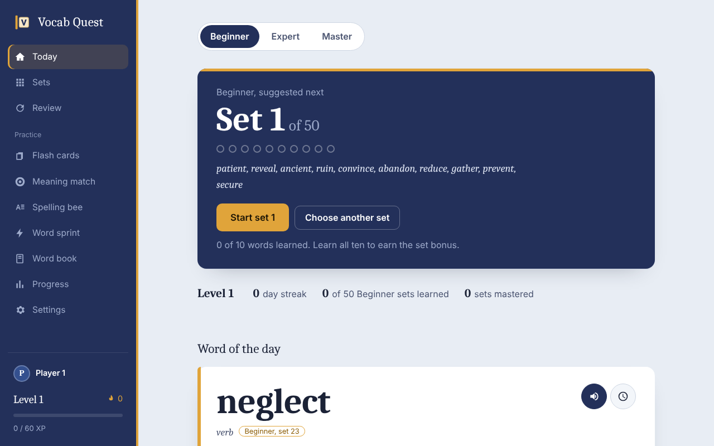

# Vocab Quest

A free desktop game for Windows that grows your English vocabulary. Hear every word spoken, practise spelling it, and learn its synonyms and antonyms while you play.



## Download

**[Download the latest version for Windows](https://github.com/DeoCookie/vocab-game/releases/latest)**, then run the **VocabQuest-Setup** file.

- Works on Windows 10 and 11 (64-bit). No admin rights needed.
- Prefer not to install? Download the **VocabQuest-Portable** file and run it from anywhere.
- The app isn't code-signed yet, so Windows may say "Windows protected your PC". Click **More info → Run anyway**.

## What's inside

- **1,500 words in three tiers:** Beginner, Expert and Master, ordered from most to least common. Each word has a definition, an example sentence, synonyms and antonyms.
- **Sets of ten.** Each tier is 50 sets in a suggested order, and you can pick any set. Each set lesson goes through:
  - meeting the words
  - matching their meanings
  - spelling them from the spoken word
  - finding synonyms and antonyms

  Learn all ten words to earn the set bonus, then remember them over the following days for a gold star.
- **Placement quiz** to find your starting point.
- **Hover definitions.** Point at any synonym or antonym to see what it means.
- **Practice games:**
  - **Flash cards:** flip through words and rate how well you know them.
  - **Meaning match:** pick the right definition from four.
  - **Spelling bee:** the word is spoken aloud and you type it out. Letter tiles show what you got right, and you can reveal a letter if you're stuck.
  - **Word sprint:** find synonyms and antonyms against a 60-second clock.
- **Pronunciation** with the voices built into Windows, at normal or slow speed. Click any synonym or antonym to hear it too.
- **Spaced repetition and reviews.** Words come back at growing intervals: ten minutes, a day, three days, a week.
- **Players.** Up to eight people can share one computer, each with their own progress.
- **XP, levels, daily streaks and 16 achievements.**
- **Word book** to browse and search all 1,500 words.
- Light and dark themes, full keyboard play (`1`–`4` to answer, `Enter` to continue), screen-reader labels, and reduced-motion support.

## Run from source (for developers)

You need [Node.js](https://nodejs.org/) 20 or newer.

```powershell
git clone https://github.com/DeoCookie/vocab-game.git
cd vocab-game
npm install
npx playwright install chromium   # browser used by the UI tests
npm start
```

### Build an installer

```powershell
npm run build:win
```

This runs lint and every test first, then writes two files to `dist\`:

- `VocabQuest-Setup-1.0.0.exe` – a normal installer (per-user, no admin rights needed).
- `VocabQuest-Portable-1.0.0.exe` – a single file you can run without installing.

The builds are unsigned, so SmartScreen may warn on first launch. See [SECURITY.md](SECURITY.md#code-signing).

### Publish a new release

GitHub builds and publishes the download for you (`.github/workflows/release.yml`):

1. Bump `version` in `package.json` and add a `CHANGELOG.md` entry.
2. Commit, then tag and push:

   ```powershell
   git tag -a v1.0.1 -m "Vocab Quest 1.0.1"
   git push origin main --follow-tags
   ```

GitHub Actions then runs every test on Windows, builds the installer and portable app, and attaches them, with SHA-256 checksums, to a new release. If any test fails, nothing is published.

## Tests

```powershell
npm run verify      # lint + unit/security tests + UI tests
npm test            # unit, data and security tests only (no browser needed)
npm run test:e2e    # drives the real UI in Chromium
```

To make every `git push` run the full suite first:

```powershell
npm run hooks:install
```

| Suite | What it checks |
| --- | --- |
| `test/unit/data.test.mjs` | 1,500 unique words, 500 per tier, 50 sets of ten; every entry complete; unique definitions and examples; definitions never give away the answer; every synonym and antonym has a hover definition |
| `test/unit/srs.test.mjs` | Spaced-repetition scheduling (no credit for cramming), learned checks, due words, word selection |
| `test/unit/sets.test.mjs` | Set status, suggested next set, lessons that resume, set bonuses paid once, placement quiz scoring |
| `test/unit/quiz.test.mjs` | Every word produces fair questions with exactly one right answer and no near-synonym distractors; spelling checks |
| `test/unit/state.test.mjs` | Profiles, upgrading version 1 saves, XP, levels, streaks, set bonuses, achievements, save-format agreement with the main process |
| `test/unit/security.test.js` | Window hardening, CSP, URL allow-listing, path traversal |
| `test/unit/main-process.test.js` | Loads the real main process against a fake Electron and checks permissions, network blocking, navigation lock-down and IPC sender checks |
| `test/unit/store.test.js` | Atomic saves, version 1 upgrade with backup, corrupt-file recovery, size limits, player limits, prototype-pollution defence |
| `test/unit/static-safety.test.mjs` | No `innerHTML`/`eval`, no remote URLs, no inline scripts, MIT license present |
| `test/e2e/app.test.mjs` | Plays a full set lesson, retries, placement, tier switching, hover definitions, players, the 1.0 save upgrade and every game end to end, with zero console errors and zero outbound requests |

## Project layout

```
src/
  main/        Electron main process (window, security, saving)
  preload/     The three-method bridge between the page and the main process
  renderer/    The game itself: HTML, CSS, ES modules and data/words.json
test/          Unit, security and end-to-end tests
build/         Installer icon
```

## Your data

Progress for every player is saved to `%APPDATA%\Vocab Quest\progress.json` and never leaves your computer. The app makes no network connections. Details in [SECURITY.md](SECURITY.md).

## Word data

The definitions, examples, synonyms and antonyms were written for this project. The order of words, both across tiers and within them, was set using word-frequency data from [FrequencyWords](https://github.com/hermitdave/FrequencyWords) (Hermit Dave, OpenSubtitles) and [wikipedia-word-frequency](https://github.com/IlyaSemenov/wikipedia-word-frequency) (Ilya Semenov), averaged across both. The frequency data itself is not included in the app.

## License

Vocab Quest is free and open-source software, released under the [MIT License](LICENSE).
